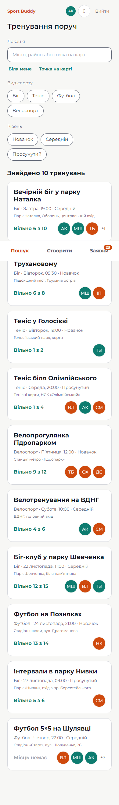
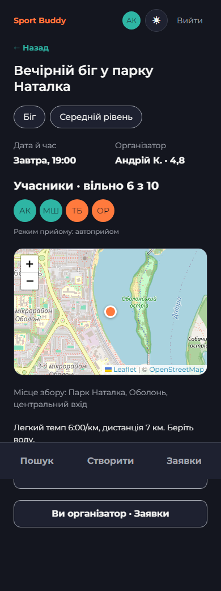
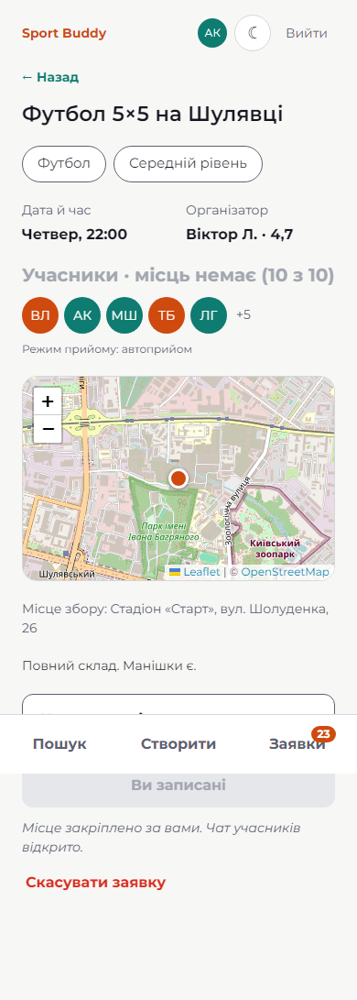
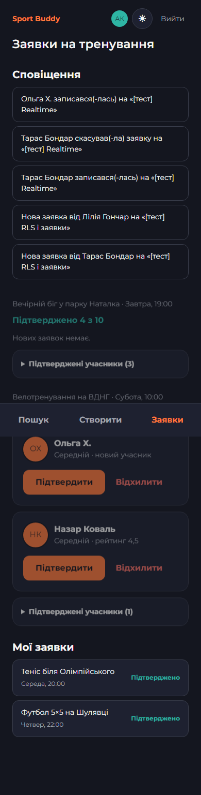

# Sport Buddy

Маркетплейс для пошуку компанії на спільні тренування (біг, теніс, футбол, велоспорт) у Києві.
Ключова фіча — картка тренування з «живими» вільними місцями й аватарками учасників (Supabase Realtime), чат учасників і карта місця збору.

> Статус: MVP готовий (лабораторна №5). План — [docs/PLAN.md](docs/PLAN.md), журнал — [docs/DEV_LOG.md](docs/DEV_LOG.md).

## Стек
Vite · React 18 · TypeScript (strict) · React Router · Tailwind CSS · Supabase (Auth, Postgres + RLS + RPC, Realtime) · Leaflet + OpenStreetMap · Nominatim · react-hook-form + zod · Vitest · Playwright · Vercel.

## Запуск локально
```bash
npm install
cp .env.example .env.local   # вписати VITE_SUPABASE_URL і VITE_SUPABASE_ANON_KEY
npm run dev                  # http://localhost:5173
```

| Команда | Що робить |
|---|---|
| `npm run dev` | dev-сервер |
| `npm run build` | перевірка типів + production-білд |
| `npm run lint` | ESLint |
| `npm test` | Vitest (чиста логіка) |
| `npm run test:db` | усі інтеграційні тести проти Supabase: пошук, гонка за останнє місце, RLS, Realtime |
| `npm run e2e` | Playwright (3 сценарії, 360 px; перед першим запуском `npx playwright install chromium`) |
| `npm run screenshots` | оновити `docs/screenshots/` |

## Змінні середовища
| Змінна | Де взяти |
|---|---|
| `VITE_SUPABASE_URL` | Supabase → Project Settings → API → Project URL |
| `VITE_SUPABASE_ANON_KEY` | там само → `anon` `public` key |

Секрети — лише в `.env.local` (у `.gitignore`) і в Environment Variables на Vercel.

## База даних
1. Supabase → SQL Editor → вставити й виконати `supabase/migrations/0001_init.sql`.
2. Там само виконати `supabase/migrations/0002_cancel_training.sql`.
3. Виконати `supabase/seed.sql` (тестові акаунти + 10 тренувань у Києві; можна перезапускати).
4. Authentication → Sign In / Providers → Email: вимкнути **Confirm email** (щоб реєстрація працювала без листа).

## Тестові акаунти (пароль для всіх: `Test1234!`)
| Email | Роль у демо-даних |
|---|---|
| `olga@sportbuddy.test` | Спортсмен (записана на велопрогулянку, чекає рішення на ВДНГ) |
| `andriy@sportbuddy.test` | Організатор «Вечірній біг у парку Наталка» та «Велотренування на ВДНГ» (є заявки) |
| `maria@sportbuddy.test` | Організатор «Ранкова пробіжка на Трухановому» (2 заявки очікують) |
| `viktor@sportbuddy.test` | Організатор повністю заповненого «Футбол 5×5 на Шулявці» |
| `lilia@`, `taras@`, `nazar@`, `oksana@`, `serhii@`, `tetiana@`, `ivan@`, `dmytro@` `sportbuddy.test` | інші учасники |

## Припущення
Див. [docs/PLAN.md → Припущення](docs/PLAN.md#припущення-не-блокуючі-прийняті).

> Інтеграційні тести створюють і скасовують власні тренування, але лишають сповіщення демо-акаунтам, а e2e-тест живого лічильника «витрачає» заявку tetiana@. **Перед показом перезапусти `seed.sql`.**

## Скриншоти
Знімки екранів (390 px) у світлій і темній темах лежать у [docs/screenshots/](docs/screenshots/). Оновити їх можна командою `npm run screenshots` (dev-сервер стартує сам).

| Пошук | Картка | Повне тренування | Заявки |
|---|---|---|---|
|  |  |  |  |

## Деплой (Vercel)
`vercel.json` переписує всі шляхи на `index.html` (SPA). У Vercel: Import Project → Framework «Vite» → Environment Variables `VITE_SUPABASE_URL` і `VITE_SUPABASE_ANON_KEY` (або `VITE_SUPABASE_PUBLISHABLE_KEY`) → Deploy. У Supabase → Authentication → URL Configuration додай адресу Vercel у Site URL / Redirect URLs (для «Забули пароль?»).

## Суперечності в матеріалах (як вирішено)
1. Мокапи: скасування «за 2 години» → за SPEC/vision board **12 годин**.
2. Мокапи: Харків (Саржин Яр, Клочківська) → **Київ**.
3. mock-06: «Ліміт учасників вичерпано…» на картці → на картці текст SPEC «Місць немає»; «Ліміт учасників досягнуто» — у вкладці «Заявки» (US 1.2).
4. DESIGN.md: неактивний текст у темній темі #5B6170 на #14161F ≈ 2.9:1 (нижче WCAG AA) → #7D828F; teal у темній темі освітлено (як на mock-*-dark).
5. Мокапи й US 2.4 показують назву тренування, а US 1.1 / mock-07 поля «назва» не мають → додано необов'язкове поле з автоназвою.
